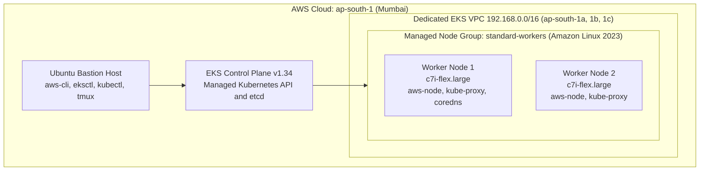

# Amazon EKS Cluster Runbook & Troubleshooting Guide

[](https://aws.amazon.com/eks/)
[](https://kubernetes.io/)
[](https://eksctl.io/)
[](https://aws.amazon.com/ec2/)

A hands-on runbook for provisioning, verifying, troubleshooting, and tearing down an **Amazon Elastic Kubernetes Service (EKS)** cluster on an AWS Free Tier account, using an Ubuntu EC2 bastion host.

It also documents **four real-world errors** encountered during setup, with the root cause and the exact fix for each.

---

## Table of Contents

1. [Overview](#1-overview)
2. [Architecture](#2-architecture)
3. [Core Concepts](#3-core-concepts)
4. [Phase 1: Prepare the Bastion Host](#4-phase-1-prepare-the-bastion-host)
5. [Phase 2: Pre-Flight AWS Checks](#5-phase-2-pre-flight-aws-checks)
6. [Phase 3: Provision the Cluster](#6-phase-3-provision-the-cluster)
7. [Phase 4: Verify and Deploy a Test App](#7-phase-4-verify-and-deploy-a-test-app)
8. [Troubleshooting](#8-troubleshooting)
9. [Phase 5: Scaling and Teardown](#9-phase-5-scaling-and-teardown)

---

## 1. Overview

| Setting | Value | Notes |
| :-- | :-- | :-- |
| AWS Region | `ap-south-1` (Mumbai) | Must match your AWS CLI default region |
| Cluster name | `my-eks-cluster` | Creates CloudFormation stack `eksctl-my-eks-cluster-cluster` |
| Kubernetes version | `v1.34` (`v1.34.11-eks`) | Selected automatically by `eksctl` |
| Node group | `standard-workers` | Managed EC2 Auto Scaling Group |
| Worker instance type | `c7i-flex.large` (2 vCPU, 4 GB RAM) | Free Tier-eligible in `ap-south-1`; supports up to 29 pods per node |
| Worker OS | Amazon Linux 2023 | Official EKS-optimized AMI |
| Node count | Desired `2`, Min `1`, Max `3` | Can be scaled to `1` to conserve Free Tier hours |

### Prerequisites

- An AWS account with an IAM user that can create EKS, EC2, IAM, and CloudFormation resources
- An Ubuntu EC2 instance (bastion host) with `aws-cli` installed and configured
- Basic familiarity with the Linux command line

> [!WARNING]
> The EKS control plane (about $0.10/hour) and the NAT Gateway are **not** covered by the Free Tier. Always complete the [teardown](#option-b-delete-the-entire-cluster) at the end of each session.

---

## 2. Architecture



---

## 3. Core Concepts

### 3.1 Why use `tmux`?

Creating an EKS cluster takes **15 to 20 minutes**: AWS builds a VPC, subnets, a NAT Gateway, the control plane (~12 min), and the worker nodes (~5 min). Browser-based terminals such as EC2 Instance Connect disconnect on network drops or idle timeouts, which would kill a running `eksctl` command and leave the cluster half-built.

`tmux` runs a persistent session on the server itself, so the build continues even if your browser disconnects.

```bash
# Start a new persistent session named "eks"
tmux new -s eks

# Reattach after a disconnect
tmux attach -t eks

# Open a new window inside tmux:  Ctrl+B, release, then C
# Switch between windows:         Ctrl+B, release, then 0 or 1
```

### 3.2 Why two worker nodes instead of one?

Think of the control plane as the *manager* that assigns work, and the worker nodes as the *machines* that actually run your Pods.

- **High availability:** With two nodes spread across Availability Zones, Kubernetes reschedules Pods to the surviving node if one fails. With a single node, a reboot or crash takes the application down.
- **Learning and testing:** A single `c7i-flex.large` node is sufficient for practice. Two workers plus the bastion consume roughly **3 instance-hours per hour** of Free Tier time, so use `--nodes 1` for daily practice.

---

## 4. Phase 1: Prepare the Bastion Host

> [!IMPORTANT]
> **Never download or extract tools inside `/tmp`.** On Ubuntu EC2, `/tmp` is a small (~455 MB) RAM-backed `tmpfs`. Extracting binaries there can fill it to 100% and leave corrupted, partially written binaries. Work from `/root` or `/home/ubuntu` instead.

### Step 1: Switch to root and change directory

```bash
sudo su -
cd /root
pwd    # Expected: /root
```

### Step 2: Check disk space

Ensure `/` has at least 2 GB available:

```bash
df -h /root /tmp
```

### Step 3: Verify `aws-cli`

```bash
aws --version
# Expected: aws-cli/2.x.x Python/3.x.x Linux/...
```

### Step 4: Install `eksctl`

```bash
cd /root
rm -f /usr/local/bin/eksctl
ARCH=amd64
PLATFORM=$(uname -s)_$ARCH
curl -sLO "https://github.com/eksctl-io/eksctl/releases/latest/download/eksctl_$PLATFORM.tar.gz"
tar -xzf eksctl_$PLATFORM.tar.gz -C /usr/local/bin
rm -f eksctl_$PLATFORM.tar.gz

eksctl version
# Expected: 0.231.0 (or newer)
```

### Step 5: Install `kubectl`

```bash
cd /root
curl -LO "https://dl.k8s.io/release/$(curl -L -s https://dl.k8s.io/release/stable.txt)/bin/linux/amd64/kubectl"
install -o root -g root -m 0755 kubectl /usr/local/bin/kubectl
rm -f kubectl

kubectl version --client
# Expected: Client Version: v1.3x.x
```

---

## 5. Phase 2: Pre-Flight AWS Checks

Before building, verify three things: your IAM identity, your target region, and which instance types your account is allowed to launch.

### Step 1: Verify IAM identity and region

```bash
aws sts get-caller-identity
aws configure get region
```

Example output (identifiers redacted):

```json
{
    "UserId": "AIDAXXXXXXXXXXXXXXXXX",
    "Account": "123456789012",
    "Arn": "arn:aws:iam::123456789012:user/<your-iam-user>"
}
```

```text
ap-south-1
```

### Step 2: List Free Tier-eligible instance types

New Free Tier accounts may **block** `t3.medium`. Check what is permitted:

```bash
aws ec2 describe-instance-types \
  --region ap-south-1 \
  --filters "Name=free-tier-eligible,Values=true" \
  --query "InstanceTypes[].[InstanceType,VCpuInfo.DefaultVCpus,MemoryInfo.SizeInMiB]" \
  --output table
```

Example output:

```text
+-----------------+----+--------+
|     DescribeInstanceTypes     |
+-----------------+----+--------+
|  t8i.micro      |  2 |  1024  |
|  t4g.small      |  2 |  2048  |
|  t3.micro       |  2 |  1024  |
|  c7i-flex.large |  2 |  4096  |   <-- selected
|  t4g.micro      |  2 |  1024  |
|  m7i-flex.large |  2 |  8192  |
|  t3.small       |  2 |  2048  |
|  t8i.small      |  2 |  2048  |
+-----------------+----+--------+
```

**Why `c7i-flex.large`:** Micro instances (1 GB RAM) are limited to about 4 Pods because of ENI/IP limits. `c7i-flex.large` is Free Tier-eligible, has 4 GB RAM, and supports up to 29 Pods per node.

### Step 3: Check for leftover failed stacks

```bash
aws cloudformation list-stacks \
  --region ap-south-1 \
  --stack-status-filter CREATE_FAILED ROLLBACK_COMPLETE DELETE_FAILED \
  --query "StackSummaries[?starts_with(StackName, 'eksctl-')].[StackName,StackStatus]" \
  --output table
```

An empty result means the account is clean.

---

## 6. Phase 3: Provision the Cluster

### Step 1: Start a persistent session

```bash
tmux new -s eks
```

Confirm the green `[eks] 0:bash*` status bar appears at the bottom of the terminal.

### Step 2: Create the cluster

```bash
eksctl create cluster \
  --name my-eks-cluster \
  --region ap-south-1 \
  --nodegroup-name standard-workers \
  --node-type c7i-flex.large \
  --nodes 2 \
  --nodes-min 1 \
  --nodes-max 3 \
  --managed
```

> [!TIP]
> To conserve Free Tier hours, use `--nodes 1`.

> [!CAUTION]
> Run this command **once**. Running it again while the first is in progress fails with `AlreadyExistsException` (see [Problem 2](#problem-2-alreadyexistsexception)).

### What happens during the build (15–20 minutes)

1. **Stack `eksctl-my-eks-cluster-cluster`:** creates the VPC (`192.168.0.0/16`), public and private subnets across three AZs, a NAT Gateway, IAM roles, and the EKS v1.34 control plane (~12 min).
2. **Add-ons:** installs `vpc-cni`, `kube-proxy`, `coredns`, and `metrics-server`.
3. **Stack `eksctl-my-eks-cluster-nodegroup-standard-workers`:** launches the `c7i-flex.large` worker nodes and joins them to the cluster (~4 min).
4. **Kubeconfig:** written automatically to `/root/.kube/config`.

---

## 7. Phase 4: Verify and Deploy a Test App

### Step 1: Update kubeconfig and check nodes

```bash
aws eks update-kubeconfig --region ap-south-1 --name my-eks-cluster
kubectl get nodes -o wide
```

Example output:

```text
NAME                                            STATUS   ROLES    AGE     VERSION                INTERNAL-IP      OS-IMAGE
ip-192-168-46-134.ap-south-1.compute.internal   Ready    <none>   3m50s   v1.34.11-eks-b9510e3   192.168.46.134   Amazon Linux 2023
ip-192-168-67-37.ap-south-1.compute.internal    Ready    <none>   3m50s   v1.34.11-eks-b9510e3   192.168.67.37    Amazon Linux 2023
```

Both nodes should report `Ready`.

### Step 2: Verify system Pods

```bash
kubectl get pods -n kube-system -o wide
```

Example output:

```text
NAME                       READY   STATUS    RESTARTS   AGE
aws-node-hztsh             2/2     Running   0          6m9s
aws-node-ntmb9             2/2     Running   0          6m9s
coredns-77f4cb5f5f-jpq6r   1/1     Running   0          11h
coredns-77f4cb5f5f-w5zwc   1/1     Running   0          11h
kube-proxy-b2m7w           1/1     Running   0          6m9s
kube-proxy-tfzlg           1/1     Running   0          6m9s
```

**Reference screenshot:** the end of a successful `eksctl` run, followed by `kubectl get nodes` and `kubectl get pods`. Both nodes are `Ready` and all system Pods are `Running`. Public IP addresses have been redacted.


### Step 3: Deploy a test Nginx application

```bash
# 1. Create a 2-replica Nginx deployment
kubectl create deployment nginx-web --image=nginx:latest --replicas=2

# 2. Expose it through an AWS Elastic Load Balancer
kubectl expose deployment nginx-web --port=80 --type=LoadBalancer

# 3. Check status; open the EXTERNAL-IP / hostname in a browser
kubectl get pods,svc -o wide
```

---

## 8. Troubleshooting

Four issues were encountered during the original setup. Each entry lists the symptom, cause, and resolution.

| # | Symptom | Root cause |
| :-- | :-- | :-- |
| 1 | `Segmentation fault` when running `eksctl` | `/tmp` RAM disk full during extraction |
| 2 | `AlreadyExistsException` on `eksctl create cluster` | Command run twice |
| 3 | Node group stack in `ROLLBACK_COMPLETE` | Instance type not Free Tier-eligible |
| 4 | `TerminationProtection is enabled` on stack delete | `eksctl` enables protection by default |

---

### Problem 1: Segmentation fault

**Symptom**

```text
root@ip-172-31-12-85:/tmp/eks-tools# df -h /tmp /usr/local/bin /root
Filesystem      Size  Used Avail Use% Mounted on
tmpfs           455M  455M     0 100% /tmp
/dev/root       6.7G  3.0G  3.7G  45% /

root@ip-172-31-12-85:/tmp/eks-tools# eksctl version
Segmentation fault         eksctl version
```

**Cause**

`aws-cli` and `eksctl` were downloaded and extracted in `/tmp/eks-tools`. The 455 MB `tmpfs` filled to 100% mid-extraction, so only part of the `eksctl` binary was written to `/usr/local/bin/eksctl`. Running the truncated binary crashes with a segmentation fault.

**Resolution**

1. Clear temporary files:
   ```bash
   rm -rf ~/.cache/* /tmp/*
   ```
2. Move to a directory on the real disk and remove the corrupted binary:
   ```bash
   cd /root
   rm -f /usr/local/bin/eksctl
   ```
3. Reinstall `eksctl` and `kubectl` from `/root` (see [Phase 1](#4-phase-1-prepare-the-bastion-host)).

---

### Problem 2: AlreadyExistsException

**Symptom**

```text
[✖] creating CloudFormation stack "eksctl-my-eks-cluster-cluster": operation error CloudFormation:
CreateStack, StatusCode: 400, AlreadyExistsException: Stack [eksctl-my-eks-cluster-cluster] already exists
Error: failed to create cluster "my-eks-cluster"
```

**Cause**

`eksctl create cluster --name my-eks-cluster` was run a second time while the first run was in progress (or after the control plane stack had already been created). CloudFormation rejects the duplicate stack name.

**Resolution**

Do not delete everything. Inspect the existing stacks first:

```bash
aws cloudformation list-stacks \
  --region ap-south-1 \
  --stack-status-filter CREATE_IN_PROGRESS CREATE_COMPLETE ROLLBACK_IN_PROGRESS ROLLBACK_COMPLETE CREATE_FAILED \
  --query "StackSummaries[?starts_with(StackName, 'eksctl-my-eks-cluster')].[StackName,StackStatus]" \
  --output table
```

In this case, `eksctl-my-eks-cluster-cluster` was already `CREATE_COMPLETE`, so the control plane was healthy and only the node group needed repair.

---

### Problem 3: Node group stuck in ROLLBACK_COMPLETE

**Symptom**

```text
+---------------------------------------------------+---------------------+
|  eksctl-my-eks-cluster-nodegroup-standard-workers |  ROLLBACK_COMPLETE  |
|  eksctl-my-eks-cluster-cluster                    |  CREATE_COMPLETE    |
+---------------------------------------------------+---------------------+
```

To find the reason:

```bash
aws cloudformation describe-stack-events \
  --region ap-south-1 \
  --stack-name eksctl-my-eks-cluster-nodegroup-standard-workers \
  --query "StackEvents[?ResourceStatus=='CREATE_FAILED'].[LogicalResourceId,ResourceStatusReason]" \
  --output table
```

Relevant error:

```text
AsgInstanceLaunchFailures: Could not launch On-Demand Instances. InvalidParameterCombination -
The specified instance type is not eligible for Free Tier.
```

**Cause**

The original command requested `--node-type t3.medium`. The account is restricted to Free Tier-eligible instance types, so AWS refused to launch the instances and rolled back the node group stack after about 23 minutes.

**Resolution**

1. Identify an eligible type (see [Phase 2, Step 2](#step-2-list-free-tier-eligible-instance-types)). `c7i-flex.large` was selected.
2. Delete the failed stack (see Problem 4).
3. Attach a new node group to the **existing** control plane instead of rebuilding the cluster (about 3 minutes):
   ```bash
   eksctl create nodegroup \
     --cluster my-eks-cluster \
     --region ap-south-1 \
     --name standard-workers \
     --node-type c7i-flex.large \
     --nodes 2 \
     --nodes-min 1 \
     --nodes-max 3 \
     --managed
   ```

---

### Problem 4: TerminationProtection is enabled

**Symptom**

```text
$ aws cloudformation delete-stack \
    --region ap-south-1 \
    --stack-name eksctl-my-eks-cluster-nodegroup-standard-workers

An error occurred (ValidationError) when calling the DeleteStack operation: Stack
[eksctl-my-eks-cluster-nodegroup-standard-workers] cannot be deleted while TerminationProtection is enabled
```

**Cause**

`eksctl` enables CloudFormation termination protection on the stacks it creates, to prevent accidental deletion from the console.

**Resolution**

Disable termination protection, then delete the stack:

```bash
# 1. Disable termination protection
aws cloudformation update-termination-protection \
  --region ap-south-1 \
  --no-enable-termination-protection \
  --stack-name eksctl-my-eks-cluster-nodegroup-standard-workers

# 2. Delete the failed stack
aws cloudformation delete-stack \
  --region ap-south-1 \
  --stack-name eksctl-my-eks-cluster-nodegroup-standard-workers
```

---

## 9. Phase 5: Scaling and Teardown

### Option A: Scale down to one node

Use this to keep the cluster running while consuming fewer Free Tier hours:

```bash
eksctl scale nodegroup \
  --cluster my-eks-cluster \
  --region ap-south-1 \
  --name standard-workers \
  --nodes 1 \
  --nodes-min 1 \
  --nodes-max 3
```

Verify after about a minute:

```bash
kubectl get nodes
```

### Option B: Delete the entire cluster

> [!WARNING]
> Do this at the end of **every** practice session. The control plane and NAT Gateway continue to incur charges while they exist.

```bash
# 1. Delete LoadBalancer services first so AWS removes the ELB
kubectl delete svc nginx-web --ignore-not-found

# 2. Delete the cluster (node group, control plane, VPC, NAT Gateway)
eksctl delete cluster --name my-eks-cluster --region ap-south-1
```

### Verify that nothing remains

```bash
aws cloudformation list-stacks \
  --region ap-south-1 \
  --stack-status-filter CREATE_COMPLETE UPDATE_COMPLETE ROLLBACK_COMPLETE DELETE_FAILED \
  --query "StackSummaries[?starts_with(StackName, 'eksctl-')].[StackName,StackStatus]" \
  --output table
```

An empty table confirms that all EKS resources have been removed.

---

## Quick Reference

| Task | Command |
| :-- | :-- |
| Create cluster | `eksctl create cluster --name my-eks-cluster --region ap-south-1 ...` |
| Update kubeconfig | `aws eks update-kubeconfig --region ap-south-1 --name my-eks-cluster` |
| List nodes | `kubectl get nodes -o wide` |
| Scale to 1 node | `eksctl scale nodegroup --cluster my-eks-cluster --name standard-workers --nodes 1` |
| Delete cluster | `eksctl delete cluster --name my-eks-cluster --region ap-south-1` |
